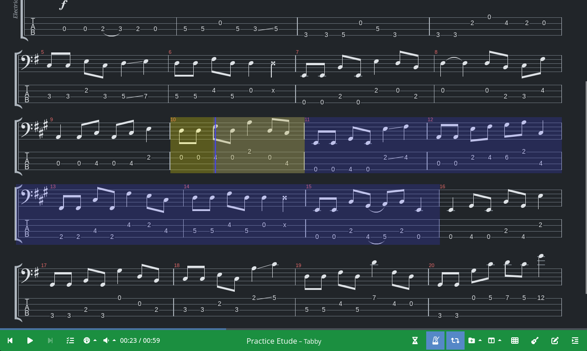
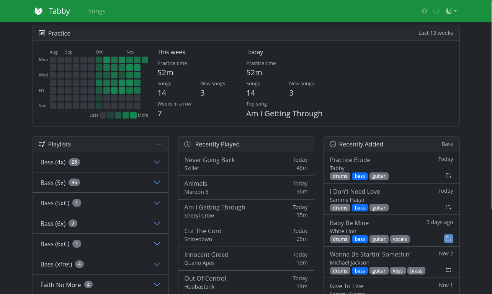

# Tabby

Tabby is a music learning and practice application for all instruments, providing play-along sheet music and tablature. Each song combines a score with a backing track and cover art, and the player follows the score in sync with the recording.

*Player*


*Dashboard*


## Features

- **Song library** — upload a score, and Tabby reads its title, artist, tempo, and tracks, classifying each track by instrument (guitar, bass, keys, drums, vocals, strings, brass, woodwinds); cover art is found automatically in online music catalogs (Deezer, iTunes)
- **Songsterr import** — search Songsterr and import a song's score, audio (from YouTube, via `yt-dlp`), and sync points in one step
- **Play-along player** — renders the score and plays it along with the backing track, kept in sync by bar-to-millisecond sync points (editable in the player)
- **Playback controls** — slow down playback, loop a selected range, count in, play a metronome, and mute or solo tracks
- **Practice Tracking** — records practice statistics and progress toward goals
- **Playlists** — ordered, reorderable song lists that the player can step through
- **Dashboard** — recently played and added songs, plus a GitHub-style calendar of daily practice time
- **Notes** — per-user metadata on each song

## Stringed Instruments

For guitar, bass, and other fretted tracks, Tabby adds:

- **Tablature** — rendered with standard notation, as the score defines its staves
- **Alternate tunings** — pick another tuning from a track's tuning menu, and an optimizer re-fingers the track with playable string and fret positions
- **Tab editing** — move individual notes to other strings, so a passage can be played in a different position
- **Saved alternate tabs** — each user's tab for each tuning is saved with the song, and can be reset to the optimizer's fingering
- **Fretboard panel** — shows the neck of the selected guitar or bass track, marked with the scale of the key at the current bar, with its root and degrees

## Supported Formats

Scores are rendered and played by [AlphaTab](https://alphatab.net), which imports:

- **Guitar Pro** — `.gp3`, `.gp4`, `.gp5`, `.gpx` (Guitar Pro 6), and `.gp` (Guitar Pro 7 and later)
- **MusicXML** — `.musicxml`, `.xml`, and compressed `.mxl`
- **Capella** — `.capx`
- **alphaTex** — `.alphatex`, AlphaTab's text notation

## Tech Stack

- **Ruby / Rails 8.1** with **PostgreSQL** (`torque-postgresql`, `online_migrations`, `passive_columns`)
- **Falcon** — async HTTP server, which also runs the **Solid Queue** job worker in production
- **Shrine** — file uploads for scores, audio, and cover images
- **Hotwire** (Turbo + Stimulus) with **Importmap** (no JS bundler)
- **HAML** templates, **Bootstrap** CSS
- **OmniAuth** (Google OAuth2) for authentication, **CanCanCan** for authorization
- **AlphaTab** — score rendering and playback in the browser, and score parsing on the server through **Nodo** (a Node.js bridge)

## Requirements

- Ruby (see `.ruby-version`) and Node.js (see `.node-version`), e.g. via [mise](https://mise.jdx.dev)
- PostgreSQL
- `yt-dlp` and `ffmpeg`, for importing audio from Songsterr
- A Google OAuth2 client, for signing in

## Setup

```bash
bin/rails credentials:edit    # see Configuration
bin/setup                     # install gems and AlphaTab, prepare the database, and start the server
```

`bin/setup` can be rerun at any time; `--reset` also resets the database, and `--skip-server` skips starting the server.

### Configuration

Secrets live in the Rails credentials:

```yaml
google:
  key: <OAuth2 client ID>
  secret: <OAuth2 client secret>
postgresql:
  url: postgres://postgres@localhost/tabby_devel
  pool: 5          # optional
```

The `POSTGRESQL_URL` and `RAILS_MAX_THREADS` environment variables override the database URL and pool size. The test database is `postgres://postgres@localhost/tabby_test`.

Uploaded files are stored in `storage/files/`.

## Testing

```bash
bundle exec rspec                                    # Ruby specs
bin/test-js                                          # JavaScript specs (Node's test runner)
bin/test-js spec/javascript/track_tab.test.mjs       # One JavaScript spec file

bin/rubocop                                          # Lint (Omakase style)
bin/brakeman                                         # Security static analysis
bin/bundler-audit                                    # Gem vulnerability scan
```

## Rake Tasks

| Task | Description |
| --- | --- |
| `songsterr:import[url]` | Import a song (score, audio, and sync points) from a Songsterr tab URL |
| `songsterr:backfill` | Fill in Songsterr metadata for songs imported before it was recorded |
| `songs:classify_tracks` | Reclassify every song's score tracks by instrument type |
| `songs:covers` | Fetch cover art for songs without covers |
| `storage:clean` | Delete stored files that no song references (lists them unless `DELETE=1`) |
| `storage:clean_cache` | Delete cached uploads older than `DAYS` days (default 7; lists them unless `DELETE=1`) |
| `build[commit]`, `push[commit]`, `deploy[commit]` | Build, push, and deploy the production Docker image |

## Deployment

Production runs the Docker image built from the `Dockerfile` (`bin/rails build`, `push`, `deploy`). Falcon (`falcon.rb`) serves the app and runs Solid Queue in a separate `jobs` service; Solid Queue and Solid Cable keep their tables in the primary database. Recurring jobs, such as the daily upload cache cleanup, are configured in `config/recurring.yml`.

## Roadmap

- **Piano/keyboard MIDI support** - read played notes via MIDI, compare with notes on sheet music (pitch and timing), display mis-played notes on staff and compute correcteness 
- **Multiuser synchronization** — users can form groups whose play state and position are broadcast to every member, so they can play along to the same song together

## Style

- HAML element attributes should use Ruby numeric and boolean literals instead of strings
- HAML attributes prefixed with `aria-` and `data-` should be in nested hashes without the prefix
- Ruby hash styles should apply to HAML attributes too
